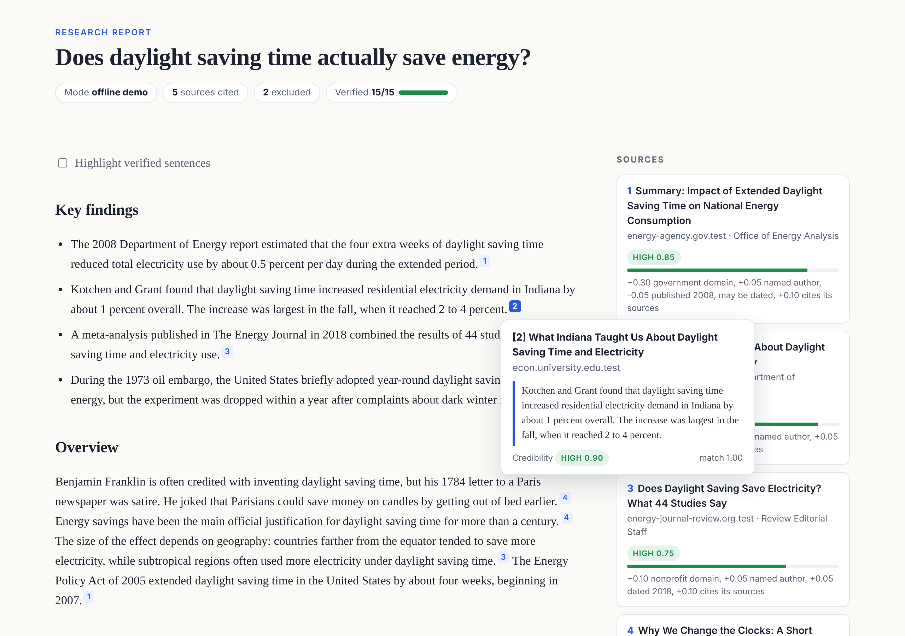
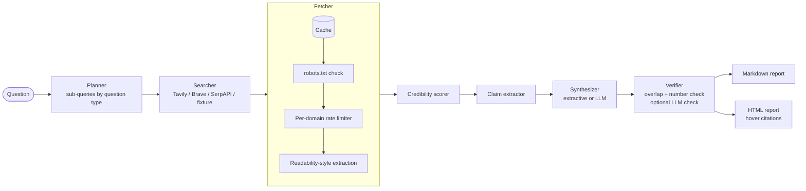

# ai-research-agent

[](https://github.com/ataperata/ai-research-agent/actions/workflows/ci.yml)


Ask a question, get a short research report where every factual sentence has a numbered
citation, and every citation has been checked against the text it points to.

```bash
research "Does daylight saving time actually save energy?"
```

Most "AI research" tools will happily cite a page that says nothing of the sort. This one
treats that as a defect to catch. A verifier reads each sentence of the finished report,
finds the passage in the cited source that best matches it, and flags the sentence if the
words do not line up or if a number in the sentence does not appear in the source. The idea
comes straight from quality work: do not trust the output, inspect it.

It runs in two modes:

* **Live**: real web search (Tavily, Brave or SerpAPI), polite fetching, and an optional
  LLM (Anthropic or OpenAI) for planning, writing and second-opinion checks.
* **Offline demo**: no API keys, no network. A bundled corpus and a deterministic
  extractive pipeline produce a real cited report, so anyone can try it in ten seconds.



*The HTML report. Hovering a citation shows the source, its credibility score and the exact
passage the verifier matched.*

## Quickstart

```bash
git clone https://github.com/ataperata/ai-research-agent
cd ai-research-agent
python -m venv .venv && source .venv/bin/activate
pip install -e ".[dev]"

research --demo            # both bundled questions, offline
research --list-demos
research --demo 2          # just the heat pump question
```

Reports land in `./reports/` as `<slug>.md` and `<slug>.html`, and the Markdown is also
printed to the terminal. Open the HTML file in a browser and hover the citation numbers.

For live research, set at least one search key:

```bash
export TAVILY_API_KEY=...        # or BRAVE_API_KEY, or SERPAPI_API_KEY
export ANTHROPIC_API_KEY=...     # optional, or OPENAI_API_KEY
research "How do mRNA vaccines work?"
```

## Example output

From `research --demo 1` (full files in [`docs/examples/`](docs/examples/)):

> ## Key findings
>
> - The 2008 Department of Energy report estimated that the four extra weeks of daylight
>   saving time reduced total electricity use by about 0.5 percent per day during the
>   extended period. [1]
> - Kotchen and Grant found that daylight saving time increased residential electricity
>   demand in Indiana by about 1 percent overall. The increase was largest in the fall,
>   when it reached 2 to 4 percent. [2]
>
> ## Measured effects
>
> Across the 44 studies, the average effect of daylight saving time was a reduction in
> electricity consumption of about 0.34 percent while it was in force. [3] Across the full
> extension, the electricity savings added up to roughly 1.3 billion kilowatt-hours, about
> 0.03 percent of total annual U.S. electricity consumption. [1]
>
> ## Excluded sources
>
> - https://everydaysavings-blog.test/private/members-energy-tips: blocked by robots.txt
> - https://everydaysavings-blog.test/2023/clocks-save-money: low credibility (0.00): -0.20
>   blog or forum, -0.05 no publication date, -0.30 sensational or absolute language

Each report also lists the sources with their credibility score and the reasons behind it,
a verification section, and the search queries the planner used.

## How it works



| Stage | What it does | Code |
| --- | --- | --- |
| Planner | Classifies the question (yes/no, how, why, compare, what), pulls out the topic words, pairs them with facets such as "Evidence from studies" and "Limits and counterpoints". With an LLM it asks the model for queries and falls back to the rules if the reply is unusable. | `planner.py` |
| Searcher | One interface, three vendors, chosen by which key is set. Results are cached. | `search/providers.py` |
| Fetcher | Cache first, then robots.txt (RFC 9309 error handling, Crawl-delay honored), then a per-domain rate limiter, then an async `httpx` request with a concurrency cap. | `fetch/` |
| Extraction | Standard library HTML parser plus the classic Readability scoring: drop nav, footers, cookie banners and sidebars, score prose blocks, keep the best container, skip reference lists. Pulls title, author and date. | `fetch/extract.py` |
| Credibility | A transparent sum of signals: domain type, author, date, whether the page cites sources, sensational language, amount of text. Every adjustment is printed in the report. Sources below 0.40 are dropped. | `credibility.py` |
| Claims | Splits sentences, scores them with BM25 against the question and each facet, rewards measured quantities and reporting verbs ("found", "estimated"), penalizes opinion. Sentences that lean on the previous one ("They found...") are joined to it or dropped. | `claims.py` |
| Synthesizer | Extractive mode picks the strongest non-redundant claims per section, at most one per source in the key findings, and cites every source that says the same thing. LLM mode asks for JSON with source ids. | `synthesize.py` |
| Verifier | For each sentence and each cited source: best-matching one or two sentence window, scored by content-word recall and character trigram similarity. Any number in the sentence must appear in that window. Results: supported, partial, weak, unsupported, uncited. | `verify.py` |

Citations are numbered by first appearance at render time, so numbers always run 1, 2, 3 in
reading order and the reference list contains only what the text cites.

## Demo mode vs live mode

| | `research --demo` | `research "question"` |
| --- | --- | --- |
| Keys needed | none | one search key; LLM key optional |
| Network | none (enforced in a test) | yes |
| Search | BM25 over the bundled corpus | Tavily, Brave or SerpAPI |
| Fetching | real `Fetcher` against an `httpx.MockTransport` that serves the corpus and its robots.txt files | real HTTP |
| Writing | deterministic extractive | LLM if a key is set, extractive otherwise |
| Verification | heuristic | heuristic, plus a model check on borderline sentences |
| Output | identical on every run | varies with the web |

The demo is not a separate code path. The same robots checks, rate limiter, cache and
extractor run in both modes; only the transport and search index are swapped. The corpus
includes a sensational blog post that the credibility scorer throws out and a page under a
`Disallow` rule that the fetcher refuses to read, so both safeguards show up in the output.

The corpus documents in `src/research_agent/demo/corpus/` were written for this project.
They summarize published work (the 2008 DOE report to Congress, Kotchen and Grant 2011,
Havranek et al. 2018, IEA heat pump figures and others), but they are summaries, not
copies of those sources, and they live on reserved `.test` domains so nobody mistakes them
for the real sites.

## Configuration

| Variable | Purpose |
| --- | --- |
| `TAVILY_API_KEY`, `BRAVE_API_KEY`, `SERPAPI_API_KEY` | search provider keys; the first one set is used |
| `RESEARCH_SEARCH` | force a provider: `tavily`, `brave` or `serpapi` |
| `ANTHROPIC_API_KEY`, `OPENAI_API_KEY` | optional LLM keys |
| `RESEARCH_LLM` | force `anthropic`, `openai` or `none` |
| `RESEARCH_LLM_MODEL` | override the default model name |

Useful flags: `--max-sources`, `--subqueries`, `--min-credibility`, `--rate-limit`
(seconds between requests to one domain, default 1.0), `--cache-dir`, `--no-cache`,
`--format md,html`, and `--strict`, which exits with status 2 if any sentence is flagged.
That last one makes the tool usable as a gate in a pipeline.

## Development

```bash
pip install -e ".[dev]"
ruff check . && ruff format --check .
pytest
```

The test suite covers planning, citation numbering, verifier flagging (wrong source,
changed number, one bad citation among good ones, missing citation), the cache (expiry,
persistence, corrupt files), the rate limiter (with a fake clock), robots.txt handling
against a mocked web, search and LLM request shapes, extraction, credibility, and demo
determinism. CI runs lint, tests and the offline demo on Python 3.11 to 3.13.

```
src/research_agent/
  cli.py            command line entry point
  pipeline.py       wires the stages together
  planner.py        question -> sub-queries
  search/           Tavily, Brave, SerpAPI, cached wrapper
  fetch/            fetcher, robots.txt, rate limiter, extraction
  credibility.py    source scoring
  claims.py         claim extraction and ranking
  synthesize.py     extractive and LLM writers
  verify.py         citation checking
  render/           Markdown and HTML output
  llm/              Anthropic and OpenAI clients over httpx
  demo/             offline corpus, fixture search, mock transport
```

## Limitations

* **The verifier checks support, not truth.** It confirms that a sentence matches what the
  cited page says. If the page is wrong, the report is wrong with a valid citation.
* **The offline check is lexical.** Recall plus trigram similarity catches wrong sources and
  altered numbers well, but a careful paraphrase can score as weak, and a sentence that
  reuses the source's words while flipping its meaning ("did not increase") can slip
  through. The optional LLM check helps on the borderline cases only.
* **Extractive writing reads like a set of quotes.** It is faithful by construction but
  does not reason across sources or resolve disagreements. LLM mode writes better prose and
  still goes through the verifier.
* **Credibility is a heuristic.** Domain type and page features are rough proxies. A .gov
  page can be outdated and a personal blog can be excellent. The reasons are shown so a
  reader can override the score in their head.
* **HTML only.** PDFs and pages that need JavaScript to render are skipped and listed as
  excluded.
* **Live mode was tested against mocked APIs.** Request and response shapes follow each
  vendor's documented format, but vendors change their APIs.

## License

MIT. See [LICENSE](LICENSE).
